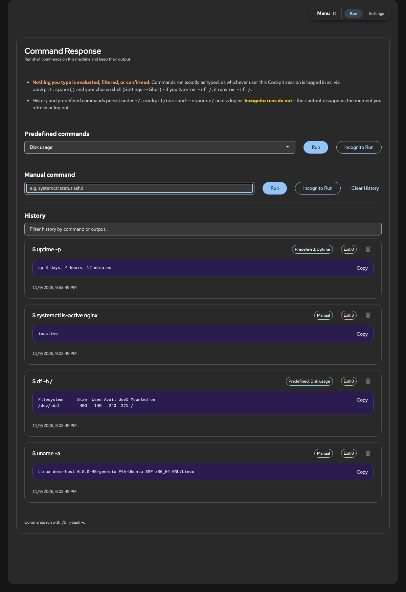
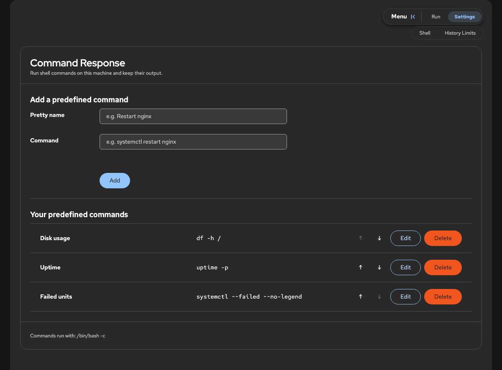
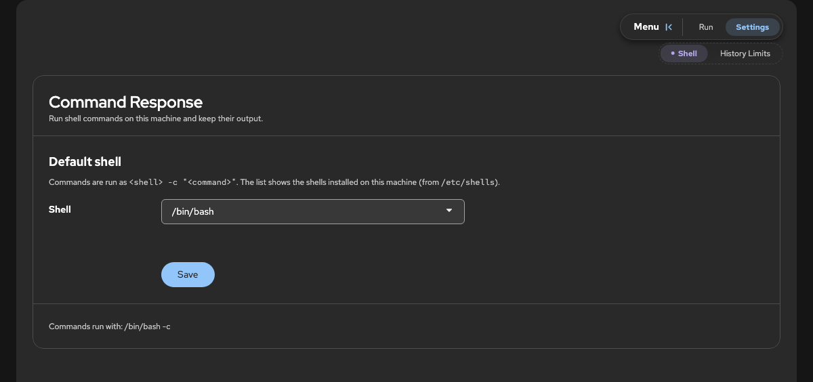
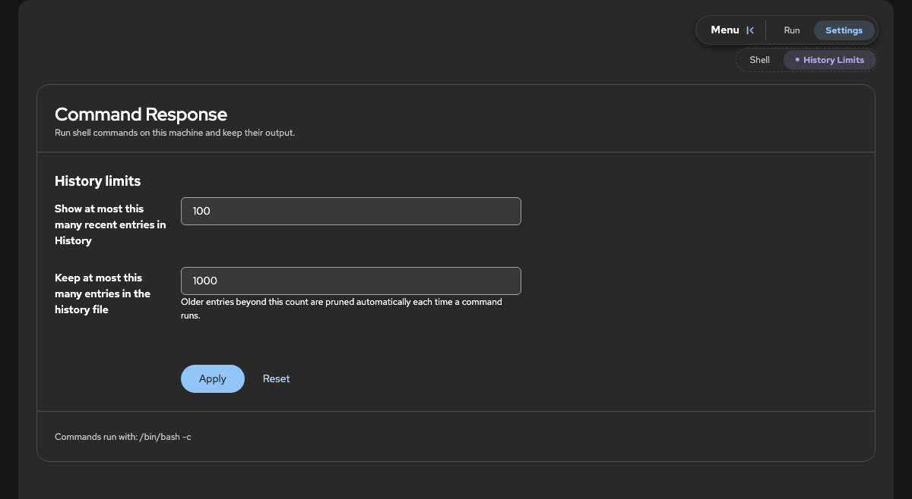

# Command Response

A small [Cockpit](https://cockpit-project.org/) page for running shell commands and keeping the results around. Type a command, hit Run, see the output. Commands you repeat can be saved as one-click shortcuts, and everything you run is logged so you can look back at it later.



I wanted something similar to OpenWRT's "Custom Commands", but enhanced. This is that.

## What it does

- **Manual commands** - type anything, get the output (stdout and stderr together) plus the exit code.
- **Predefined commands** - give a command a friendly name on the Settings tab and it shows up in a dropdown on the Run tab. Add, edit, delete and reorder them there.
- **Persistent history** - every run is saved with its output, source (manual or predefined), exit code and timestamp. It's still there after you log out and back in.
- **Incognito Run** - runs the command and shows the output, but nothing is written to disk. The card is outlined in purple so you don't mistake it for saved history, and refreshing the page makes it disappear.
- **Delete any entry** - the trash icon removes a card, and for saved entries it removes it from the history file too.
- **Copy button** on every output block.
- **Filter box** to search history by command or output.
- **History limits** - choose how many entries to show and how many to keep in the file. Older ones are pruned automatically.
- **Choose your shell** - Settings → Shell lists the shells installed on the machine (from `/etc/shells`) plus a Custom option for any program, with optional arguments. Commands run as `<shell> -c "<command>"`. Defaults to bash.
- **Follows Cockpit's theme** - light/dark and fonts come from Cockpit itself.
- **No build step** - plain HTML, CSS and JavaScript with PatternFly bundled in. No npm, no Node on the target machine.

## Screenshots

Dark mode, following Cockpit's theme.

| Settings: predefined commands | Settings: shell | Settings: history limits |
|---|---|---|
|  |  |  |

## How it differs from the Terminal tab

Cockpit already has a Terminal page, and it's the better tool for a lot of things. This isn't a replacement for it.

| | Command Response | Terminal |
|---|---|---|
| Saved shortcuts for common commands | Yes, named and ordered how you like | No (shell aliases/history only) |
| Output kept after logout | Yes, per command, with exit code | Only what you can scroll back to |
| Run something without leaving a trace | Incognito Run | Not really (shell history) |
| Search past commands and their output | Yes | Ctrl+R finds the command, not its output |
| Interactive programs (`vim`, `top`, `ssh`, prompts) | No | Yes |
| Shell state between commands (`cd`, exported variables) | No, each command is a fresh `<shell> -c` | Yes |
| Long-running or streaming output | Shown when the command finishes | Live |

In short: use this for quick, one-shot commands you run often and want a record of, and use the Terminal for anything interactive.

## Heads up

Commands run exactly as typed, as whichever user your Cockpit session is logged in as. Nothing is checked or confirmed first, so `rm -rf /` will run `rm -rf /`. It asks Cockpit for administrative access when available (the same as the "Administrative access" toggle), so be careful what you save as a shortcut.

## Installing

The target machine needs Cockpit 175 or newer and the commands listed in `preflight.json`: `mkdir`.

### Recommended: Crewmate

Try [Crewmate](https://github.com/Crewpit/crewmate) first. It is the recommended package manager for Crewpit apps and can install **cockpit-command-response** straight from this repository, [Crewpit/cockpit-command-response](https://github.com/Crewpit/cockpit-command-response).

### Manual

Get the code, then copy it into `/usr/share/cockpit/cockpit-command-response` on the machine you want to run commands on:

```bash
git clone https://github.com/Crewpit/cockpit-command-response.git
cd cockpit-command-response
```

With `rsync` (needs `rsync` on both ends):

```bash
rsync -rvh --exclude .git --exclude screenshots ./ root@<host>:/usr/share/cockpit/cockpit-command-response/
```

Or with `scp`:

```bash
scp -r . root@<host>:/usr/share/cockpit/cockpit-command-response
```

If you are already on the target machine, `cp -r . /usr/share/cockpit/cockpit-command-response` as root does the same.

Reload Cockpit in the browser and **Command Response** shows up in the sidebar under Tools. Cockpit lists a package's files when you log in, so after adding a new file (not just editing one), log out and back in or it will 404.

To update, pull the latest changes and copy them over again.

## Where your data lives

Everything is stored per user in `~/.cockpit/command-response/`, created on first load:

- `history` - past runs
- `user-defined` - your predefined commands
- `settings` - history limits and the chosen shell

They're plain JSON, so you can read or back them up by hand. Delete the folder to start fresh; it'll be recreated with defaults.